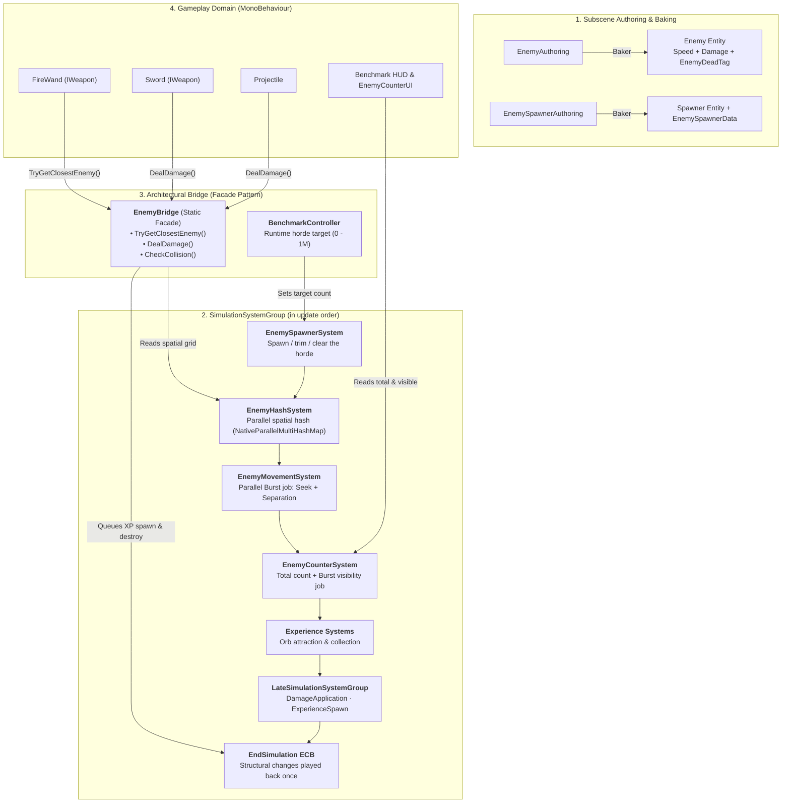

# Roguelike Benchmark: Classic OOP vs. Unity DOTS/ECS

[](https://unity.com/)
[](https://unity.com/dots)
[](https://docs.unity3d.com/Packages/com.unity.burst@latest)
[](#phase-2-dotsecs-hybrid-architecture)

A performance benchmark and portfolio project developed in **Unity 6**. The same Survivor-like game is implemented twice, once with **classic Object-Oriented Programming (MonoBehaviour)** and once with the **Data-Oriented Technology Stack (DOTS / ECS)**, then profiled under identical conditions to measure where each architecture reaches its limits, and why.


<a id="key-results"></a>
## Key Results

| | Classic OOP | DOTS / ECS |
|:---|:---:|:---:|
| **Simulation time @ 10,000 enemies** | 45.59 ms | **0.50 ms** (×91) |
| **Max playable horde (≥ 30 FPS)** | ~8,000 | **~250,000** (~40 FPS) |
| **Simulation cost per enemy** | ~4.6 µs | **~0.04 µs** (~110× less) |

> Simulating **1,000,000** enemies with DOTS (40.57 ms) takes less time than simulating **10,000** with OOP (45.59 ms).

<picture>
  <source media="(prefers-color-scheme: dark)" srcset="Documentation/images/benchmark_chart_dark.png">
  
</picture>

Full methodology and per-step analysis: [Performance Comparison](#performance-comparison-hardware-analysis) · [Complete report (PDF)](Documentation/Roguelike_Performance_Report.pdf)

---

## Table of Contents
1. [Project Overview](#project-overview)
2. [Phase 1: Classic OOP Architecture & Profiling](#phase-1-classic-oop-architecture-profiling)
3. [Phase 2: DOTS/ECS & Hybrid Architecture](#phase-2-dotsecs-hybrid-architecture)
4. [Performance Comparison & Hardware Analysis](#performance-comparison-hardware-analysis)
5. [Challenges & Lessons Learned](#challenges-lessons-learned)
6. [Next Steps](#next-steps)
7. [Getting Started](#getting-started)
8. [Controls & In-Game Benchmark HUD](#controls-in-game-benchmark-hud)
9. [Code Conventions](#code-conventions)
10. [Tech Stack](#tech-stack)

---

<a id="project-overview"></a>
## Project Overview

In Survivor-like games, thousands of enemies chase the player at the same time. Updating and rendering that many agents every frame is one of the most demanding workloads for a game engine.

This project implements the same game mechanics twice:
1. **OOP implementation**: standard Unity `MonoBehaviour` development, optimized with object pooling, a 2D spatial hash grid and time-sliced Boids steering.
2. **DOTS/ECS implementation**: the enemy simulation rebuilt with **Entities**, the **C# Job System** and the **Burst Compiler**, rendered through **Entities Graphics**.

An **in-game benchmark controller** changes the horde size at runtime, from 1,000 up to 1,000,000 enemies, without recompiling.

---

<a id="phase-1-classic-oop-architecture-profiling"></a>
## Phase 1: Classic OOP Architecture & Profiling

### Architecture


1. **Observer Pattern**: `Player` acts as `ISubject` and notifies the UI (`ExperienceBar`, `LevelUpManager`) without direct dependencies.
2. **Strategy Pattern for Weapons**: `WeaponManager` updates every weapon through the `IWeapon` interface. Weapon stats are data-driven `ScriptableObject` assets (`WeaponUpgradeData`), so new weapons can be added from the Inspector.
3. **Spatial Hash Grid**: reduces neighbor search from $\mathcal{O}(n^2)$ to $\mathcal{O}(n)$ by mapping enemies into 2D cells: each query only scans the neighboring cells instead of every enemy.
4. **Object Pooling**: enemies, projectiles, damage texts and experience gems are pre-allocated, keeping allocations on the critical path to **0 – 1 KB per frame**.
5. **Boids-Inspired Horde Steering**: each enemy blends a *Seek* vector (towards the player) with a smoothed, time-sliced *Separation* vector (`Vector3.Lerp`) to avoid overlapping without visible teleportation.

### Profiling & Identifying the Bottleneck

The Unity Profiler points to `EnemyPool.Update() -> Enemy.Tick()` as the main cost of the frame:


Custom profiler samples inside `Enemy.Tick()` show that the steering calculations (`1_Enemy_Maths_Boids`) account for more than **75% of the frame CPU time**:


Even with the spatial grid, neighbor caching and separation updates spread over 4 frames, the horde steering runs on a single thread and its cost grows with every enemy added.

<a id="oop-benchmark-results"></a>
### OOP Benchmark Results

| Enemy Count | `EnemyPool.Update()` (ms) | Observed FPS | Playability |
|:---:|:---:|:---:|:---|
| **2,000** | 4.21 ms | > 144 FPS | Smooth and stable |
| **4,000** | 8.94 ms | ~120 FPS | Minor drops below the monitor refresh rate |
| **6,000** | 19.64 ms | ~60 FPS | Playable |
| **8,000** | 35.40 ms | ~30 FPS | Degraded, practical limit |
| **10,000** | **45.59 ms** | **< 20 FPS** | **Unplayable** |

> **OOP Conclusion**: the playable limit of the OOP implementation is **~8,000 enemies** (~30 FPS). The root cause is not the algorithm itself but the memory layout: each `GameObject` and `MonoBehaviour` is a separate object scattered across the heap, so the CPU spends much of its time waiting for data (cache misses), all on a single thread.

---

<a id="phase-2-dotsecs-hybrid-architecture"></a>
## Phase 2: DOTS/ECS & Hybrid Architecture

Only the massive part of the game (enemies and experience orbs) moved to ECS. The player, the weapons and the UI remain MonoBehaviours: converting objects that exist once brings no measurable gain and makes gameplay code harder to iterate on.

### Data-Oriented Pipeline & Hybrid Bridge



### Data-Oriented Design (DOD) Principles

```
Classic OOP (scattered heap objects):
[ Enemy 1: Transform | Health | Speed | Sprite ] -> pointer -> [ Enemy 2 ] -> ...   (cache misses)

DOTS / ECS (Structure of Arrays in 16 KB archetype chunks):
Chunk: [ Transform | Transform | Transform ... ]   <-- read linearly, prefetched by the CPU
       [ Speed     | Speed     | Speed     ... ]   <-- processed by Burst jobs on all cores
```

- **Archetype Chunks**: entities with the same set of components are packed contiguously in 16 KB chunks.
- **Cache Locality**: systems iterate over linear arrays, which the CPU prefetches efficiently.
- **Burst + Job System**: jobs are compiled to optimized native code (LLVM) and spread across all worker threads.

### Core Systems Overview

1. [`EnemySpawnerSystem`](Assets/Scripts/Enemy/EnemySpawnerSystem.cs): instantiates enemies along the camera edges in batches (up to 25,000 per frame) until the target count is reached, and trims or clears the horde when the target drops. Runs first so its immediate destructions never invalidate commands queued by other systems.
2. [`EnemyHashSystem`](Assets/Scripts/Enemy/EnemyHashSystem.cs): fills a `NativeParallelMultiHashMap<int2, EnemyGridData>` with a parallel Burst job. Its capacity grows with the horde and shrinks with hysteresis to avoid frequent reallocations.
3. [`EnemyMovementSystem`](Assets/Scripts/Enemy/EnemyMovementSystem.cs): parallel Burst `IJobEntity` combining *Seek* and *Separation*. Separation is time-sliced over 4 frames, limited to 4 neighbors, and visits cells in a spiral order to avoid directional bias. Enemies touching the player are destroyed through the command buffer.
4. [`EnemyCounterSystem`](Assets/Scripts/UI/EnemyCounterSystem.cs): reads the total count from chunk metadata and counts on-screen enemies with a Burst job, for the HUD.
5. [`ExperienceMovementSystem` / `ExperienceCollectionSystem`](Assets/Scripts/Experience/ExperienceMovementSystem.cs) and [`ExperienceSpawnSystem`](Assets/Scripts/Experience/ExperienceSpawnerSystem.cs): attract experience orbs towards the player, collect them, and spawn new ones where enemies die.
6. [`DamageApplicationSystem`](Assets/Scripts/Enemy/EnemyDamageSystem.cs): sums the damage dealt by enemies during the frame and applies it to the player once.

### Decoupling with the EnemyBridge Facade

[`EnemyBridge`](Assets/Scripts/Enemy/EnemyBridge.cs) keeps the gameplay code independent from ECS:
- **No leaky abstractions**: weapons and projectiles never import `Unity.Entities` nor access the ECS world directly.
- **Encapsulated grid**: the cell size is `internal` to the simulation; weapons simply call `EnemyBridge.TryGetClosestEnemy(origin, range, out target)`.
- **Single-pass damage**: `DealDamage` destroys the enemies in range and returns the hit count in one grid traversal, instead of a collision check followed by a damage query.

---

<a id="performance-comparison-hardware-analysis"></a>
## Performance Comparison & Hardware Analysis

### Test Machine

| Component | Specification |
|:---|:---|
| **Laptop** | HP Victus 15-fa0xxx |
| **CPU** | Intel Core i5-12450H (8 cores: 4 Performance + 4 Efficient, 12 threads) |
| **GPU** | NVIDIA GeForce RTX 3050 Laptop GPU (4 GB) |
| **RAM** | 16 GB DDR4 3200 MT/s |
| **OS** | Windows 11 (64-bit) |

### Methodology

- **Same conditions**: both implementations were measured on the machine above, in a development build connected to the Unity Profiler (no Editor overhead).
- **Simulation metric**: OOP measures `EnemyPool.Update()`; DOTS measures `SimulationSystemGroup` on the main thread. Since DOTS jobs run on worker threads, this includes scheduling the jobs *and waiting for them*, plus the XP orbs and the spawner: a slightly pessimistic but fair equivalent.
- **Frame metric**: `PlayerLoop`, the whole CPU frame (simulation, rendering preparation, UI).
- **Scenario**: the player stands still with a single weapon active, so the horde size stays stable during the capture.
- **Protocol**: profiler values come from a representative frame once the horde size is stable. FPS values are read from the in-game FPS counter.

### DOTS / ECS Results

| Enemies | Simulation (ms) | Time per Enemy (µs) | Full CPU Frame (ms) | In-game FPS |
|:---:|:---:|:---:|:---:|:---:|
| 2,000 | 0.24 | 0.120 | 2.73 | — |
| 4,000 | 0.29 | 0.073 | 2.62 | — |
| 6,000 | 0.31 | 0.052 | 2.63 | — |
| 8,000 | 0.41 | 0.051 | 3.04 | — |
| 10,000 | 0.50 | 0.050 | 2.78 | ~300 |
| 50,000 | 1.92 | 0.038 | 6.83 | ~160 |
| 100,000 | 4.14 | 0.041 | 9.88 | ~100 |
| **250,000** | **9.08** | **0.036** | **22.93** | **~40** |
| 500,000 | 19.02 | 0.038 | 43.00 | ~20 |
| 1,000,000 | 40.57 | 0.041 | 88.62 | ~10 |

Up to 10,000 enemies the cost is dominated by the fixed overhead of the ECS pipeline (system updates, job scheduling, synchronization). From 50,000 onwards, the simulation scales linearly at **~0.04 µs per enemy**.

<details>
<summary><b>Profiler captures (10k · 250k · 1M)</b></summary>

**10,000 enemies**: `SimulationSystemGroup` 0.50 ms, `PlayerLoop` 2.78 ms


**250,000 enemies**: `SimulationSystemGroup` 9.08 ms, `PlayerLoop` 22.93 ms (practical limit)


**1,000,000 enemies**: `SimulationSystemGroup` 40.57 ms, `PlayerLoop` 88.62 ms


</details>

### Multithreading in Action (Timeline, 100,000 enemies)


- **Every worker thread runs the enemy jobs at the same time**: `HashEnemiesJob` (~1.30 ms) then `EnemyMovementJob` (~0.88 ms), split across all cores. In OOP, this whole workload ran sequentially on the main thread.
- **The main thread only waits**: it schedules the jobs, then blocks in `JobHandle.Complete` (2.47 ms) inside the end-of-simulation command buffer system, which must wait for `EnemyMovementJob` before playing back its commands.
- **Building the spatial grid costs more than moving the enemies** (1.30 ms vs. 0.88 ms): every enemy inserts itself into a single shared `NativeParallelMultiHashMap`, and these concurrent insertions most likely cost more than the steering math itself.

### OOP vs. DOTS / ECS

| Enemies | OOP `EnemyPool.Update()` | DOTS `SimulationSystemGroup` | Speed-up |
|:---:|:---:|:---:|:---:|
| 2,000 | 4.21 ms | 0.24 ms | ×17.5 |
| 4,000 | 8.94 ms | 0.29 ms | ×30.8 |
| 6,000 | 19.64 ms | 0.31 ms | ×63.4 |
| 8,000 | 35.40 ms | 0.41 ms | ×86.3 |
| 10,000 | 45.59 ms | 0.50 ms | **×91.2** |

| Metric | Classic OOP (MonoBehaviour) | Unity DOTS / ECS | Improvement |
|:---|:---:|:---:|:---:|
| **Max Playable Entities (≥ 30 FPS)** | ~8,000 | **~250,000** (~40 FPS) | **~30×** |
| **Highest Count Tested** | 10,000 (< 20 FPS) | 1,000,000 (~10 FPS) | 100× |
| **Simulation Cost per Enemy** | ~4.6 µs (10k) | **~0.04 µs** | **~110×** |
| **Full CPU Frame @ 10,000 Entities** | 54.63 ms | **2.78 ms** | **~20×** |
| **Simulation Allocations per Frame** | 0 – 1 KB | **0 B** (102 B above 50k) | Negligible GC pressure |
| **Thread Utilization** | Main thread only | All job worker threads | Parallel |
| **Memory Layout** | Heap objects (scattered pointers) | Contiguous archetype chunks (SoA) | Far fewer cache misses |

### Where the New Bottleneck Is

- **The simulation is no longer the whole story**: with a large horde it only represents ~40–45% of the CPU frame. The rest goes to rendering and engine overhead, which explains why the full-frame gain (~20×) is smaller than the simulation gain (~91×). At 100,000 enemies, `PresentationSystemGroup` takes ~2.8 ms, and Entities Graphics uploads the enemies' transforms to the GPU with `ExecuteGpuUploads`, itself spread across all worker threads (~1.08 ms each):


- **CPU is not the only limit**: the in-game FPS stays slightly below what the CPU frame alone would allow (~300 FPS observed vs. ~360 at 10,000 enemies), the difference coming from the GPU / render thread, which the main-thread profiler does not capture.
- **Spawning**: new enemies are instantiated on the main thread in batches of up to 25,000 per frame, which causes visible spikes when the target count is raised.
- **Garbage collection**: the ~9 KB allocated per frame on the `PlayerLoop` come from `PostLateUpdate.FinishFrameRendering` (render pipeline), not from the ECS simulation.
- **Not isolated here**: the gain combines contiguous memory, Burst compilation and multithreading, and the rendering path also differs (`SpriteRenderer` vs. Entities Graphics).

---

<a id="challenges-lessons-learned"></a>
## Challenges & Lessons Learned

- **Command buffers delay structural changes, which makes double destruction possible.** An enemy hit by two projectiles in the same frame was queued for destruction twice, dropping two XP orbs and throwing an exception during playback. Each enemy now carries an enableable `EnemyDeadTag`, switched on as soon as its destruction is queued; weapons, player contact and the spawner all skip enemies that are already dying.
- **System order matters as soon as a system makes immediate structural changes.** Clearing the horde destroyed the XP orbs immediately, while a job had already queued a component addition on some of them, so the playback failed at random. The spawner now explicitly runs before the systems that record commands (`[UpdateBefore]`), instead of relying on an implicit order.
- **Main-thread time is not job time.** In ECS, a system only schedules its job: its own time is close to zero, and the real cost appears where the main thread waits for the job (here, in the end-of-simulation command buffer). Measuring the whole `SimulationSystemGroup`, or using the Timeline view, gives the real picture.
- **ECS has a fixed cost.** Below ~10,000 enemies, updating systems and scheduling jobs costs more than the enemies themselves, which is why the DOTS times barely move between 2,000 and 10,000.

---

<a id="next-steps"></a>
## Next Steps

- **Let the movement job overlap with rendering**: `EnemyMovementJob` writes into the end-of-simulation command buffer (enemies touching the player), which forces the main thread to wait ~2.5 ms for it every frame at 100k enemies. Flagging those enemies instead and destroying them in a separate system would let the job keep running while the main thread prepares the rendering.
- **Cheaper spatial grid**: replace the concurrent hash map insertions, now the most expensive job, with a sort-based grid (count enemies per cell, then fill contiguous arrays).
- Move the spawning loop into a Burst job to remove the spikes when the horde grows.
- Isolate the respective contributions of Burst and multithreading (single worker thread vs. all threads).
- Measure medians over several hundred frames with the Profile Analyzer.

---

<a id="getting-started"></a>
## Getting Started

**Requirements**: Unity **6000.4.0f1** (the DOTS packages are resolved automatically from `Packages/manifest.json`).

| Branch | Content |
|:---|:---|
| `main` | DOTS / ECS implementation |
| `ObjectOrientedProgramming` | Classic OOP implementation (Phase 1) |

1. Clone the repository and check out the branch to benchmark.
2. Open the project in Unity and load `Assets/Scenes/SampleScene.unity`.
3. To reproduce the measurements, create a **Development Build** with **Autoconnect Profiler** enabled, then use the [benchmark HUD](#controls-in-game-benchmark-hud) to set the horde size.

---

<a id="controls-in-game-benchmark-hud"></a>
## Controls & In-Game Benchmark HUD

| Hotkey / Control | Action | Details |
|:---:|:---|:---|
| **1 – 7** (Main / Numpad) | **Target Presets** | `1`: 1,000 &bull; `2`: 5,000 &bull; `3`: 10,000 &bull; `4`: 50,000 &bull; `5`: 100,000 &bull; `6`: 500,000 &bull; `7`: 1,000,000 |
| **+** / **-** | **Horde Step** | Adjust horde target by $\pm$ 10,000 (Hold **Shift** for $\pm$ 50,000) |
| **HUD buttons** | **Fine Adjustments** | `-50k` &bull; `-10k` &bull; `-1k` &bull; `+1k` &bull; `+10k` &bull; `+50k` &bull; `Clear All` |
| **C** or **Delete** | **Clear All** | Destroys all active enemies and XP orbs |
| **F1** | **Toggle HUD** | Shows / hides the on-screen benchmark interface |
| **Z, Q, S, D** / Arrows | **Movement** | Player controls |

---

<a id="code-conventions"></a>
## Code Conventions

- **Project naming conventions**: `m` prefix for fields (`mSpatialGrid`), `p` for parameters (`pDeltaTime`), `l` for local variables (`lPlayerPos`).
- **Native memory**: every native container (`NativeArray`, `NativeParallelMultiHashMap`, `NativeReference`) is disposed in `OnDestroy()`.
- **Safe structural changes**: existence checks and the `EnemyDeadTag` marker guard every command buffer destruction.
- **Documentation**: public types, systems and methods are documented with XML doc comments.

---

<a id="tech-stack"></a>
## Tech Stack
- **Engine**: Unity 6 (6000.4.0f1)
- **DOTS Packages**: `com.unity.entities` (6.4.0), `com.unity.entities.graphics` (6.4.0), `com.unity.burst` (1.8.29), `com.unity.mathematics` (1.3.3)
- **Input System**: `com.unity.inputsystem` (1.19.0)
- **Rendering**: Universal Render Pipeline (17.4.0), Entities Graphics (`BatchRendererGroup`)
