# Roguelike Benchmark: Classic OOP vs. Unity DOTS/ECS

[](https://unity.com/)
[](https://unity.com/dots)
[](https://docs.unity3d.com/Packages/com.unity.burst@latest)
[](#phase-2-dotsecs-hybrid-architecture)

A performance benchmark and portfolio project developed in **Unity 6**. The same Survivor-like game is implemented twice, once with **classic Object-Oriented Programming (MonoBehaviour)** and once with the **Data-Oriented Technology Stack (DOTS / ECS)**, then profiled under identical conditions to measure where each architecture reaches its limits, and why.

The DOTS version is also a **playable game**: a 5-minute survival run against a horde of up to 20,000 enemies, ending with a final boss (see [Game Mode](#game-mode)).

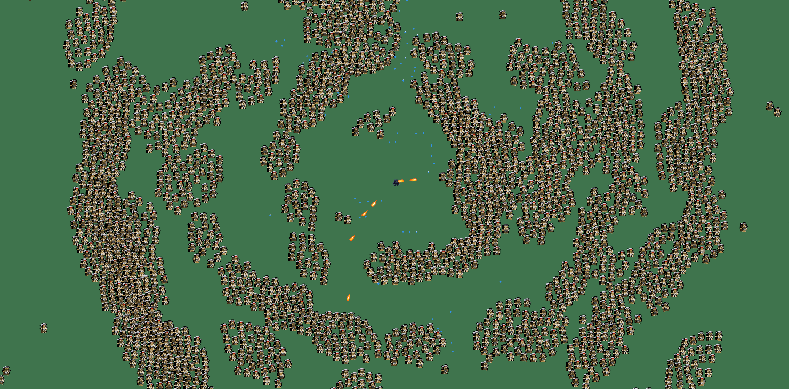

<a id="key-results"></a>
## Key Results

| | Classic OOP | DOTS / ECS |
|:---|:---:|:---:|
| **Simulation time @ 10,000 enemies** | 45.59 ms | **0.50 ms** (×91) |
| **Max playable horde (≥ 30 FPS)** | ~8,000 | **~250,000** (~40 FPS) |
| **Simulation cost per enemy** | ~4.6 µs | **~0.04 µs** (~110× less) |

> Simulating **1,000,000** enemies with DOTS (40.57 ms) takes less time than simulating **10,000** with OOP (45.59 ms).

A third phase then uses the profiler's Timeline to optimize the DOTS pipeline itself: the main-thread sync point is gone, the spatial grid costs half the CPU time, and the frame is now bound by the render thread rather than the simulation. See [Phase 3](#phase-3-profiling-driven-optimization).

<picture>
  <source media="(prefers-color-scheme: dark)" srcset="Documentation/images/benchmark_chart_dark.png">
  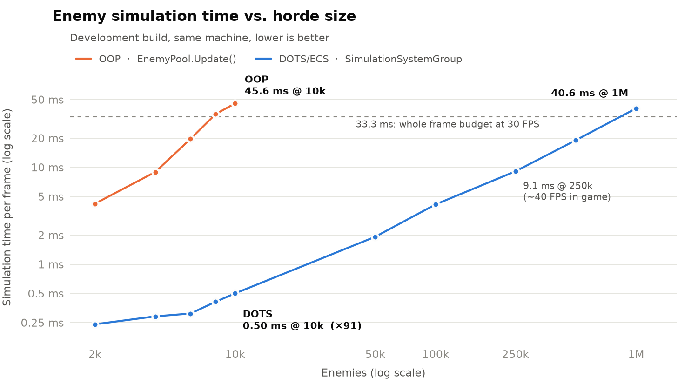
</picture>

Full methodology and per-step analysis: [Performance Comparison](#performance-comparison-hardware-analysis) · [Complete report (PDF)](Documentation/Roguelike_Performance_Report.pdf)

---

## Table of Contents
1. [Project Overview](#project-overview)
2. [Phase 1: Classic OOP Architecture & Profiling](#phase-1-classic-oop-architecture-profiling)
3. [Phase 2: DOTS/ECS & Hybrid Architecture](#phase-2-dotsecs-hybrid-architecture)
4. [Performance Comparison & Hardware Analysis](#performance-comparison-hardware-analysis)
5. [Phase 3: Profiling-Driven Optimization](#phase-3-profiling-driven-optimization)
6. [Game Mode: A Playable Survivor-like on Top of ECS](#game-mode)
7. [Challenges & Lessons Learned](#challenges-lessons-learned)
8. [Next Steps](#next-steps)
9. [Getting Started](#getting-started)
10. [Controls & In-Game Benchmark HUD](#controls-in-game-benchmark-hud)
11. [Code Conventions](#code-conventions)
12. [Tech Stack](#tech-stack)

---

<a id="project-overview"></a>
## Project Overview

In Survivor-like games, thousands of enemies chase the player at the same time. Updating and rendering that many agents every frame is one of the most demanding workloads for a game engine.

This project implements the same game mechanics twice:
1. **OOP implementation**: standard Unity `MonoBehaviour` development, optimized with object pooling, a 2D spatial hash grid and time-sliced Boids steering.
2. **DOTS/ECS implementation**: the enemy simulation rebuilt with **Entities**, the **C# Job System** and the **Burst Compiler**, rendered through **Entities Graphics**.

An **in-game benchmark controller** changes the horde size at runtime, from 1,000 up to 1,000,000 enemies, without recompiling.

---

<a id="phase-1-classic-oop-architecture-profiling"></a>
## Phase 1: Classic OOP Architecture & Profiling

### Architecture

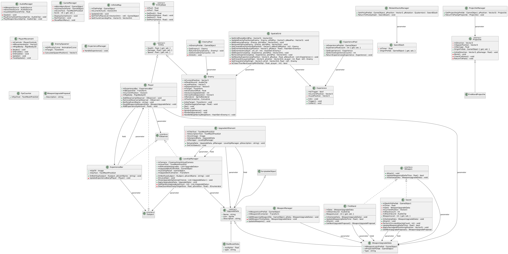

1. **Observer Pattern**: `Player` acts as `ISubject` and notifies the UI (`ExperienceBar`, `LevelUpManager`) without direct dependencies.
2. **Strategy Pattern for Weapons**: `WeaponManager` updates every weapon through the `IWeapon` interface. Weapon stats are data-driven `ScriptableObject` assets (`WeaponUpgradeData`), so new weapons can be added from the Inspector.
3. **Spatial Hash Grid**: reduces neighbor search from $\mathcal{O}(n^2)$ to $\mathcal{O}(n)$ by mapping enemies into 2D cells: each query only scans the neighboring cells instead of every enemy.
4. **Object Pooling**: enemies, projectiles, damage texts and experience gems are pre-allocated, keeping allocations on the critical path to **0 – 1 KB per frame**.
5. **Boids-Inspired Horde Steering**: each enemy blends a *Seek* vector (towards the player) with a smoothed, time-sliced *Separation* vector (`Vector3.Lerp`) to avoid overlapping without visible teleportation.

### Profiling & Identifying the Bottleneck

The Unity Profiler points to `EnemyPool.Update() -> Enemy.Tick()` as the main cost of the frame:

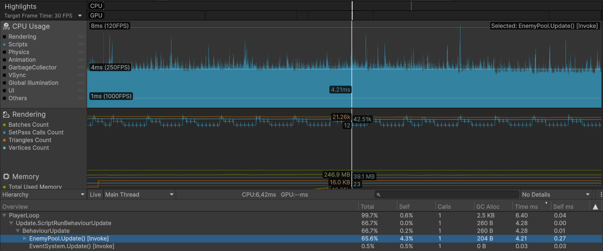

Custom profiler samples inside `Enemy.Tick()` show that the steering calculations (`1_Enemy_Maths_Boids`) account for more than **75% of the frame CPU time**:

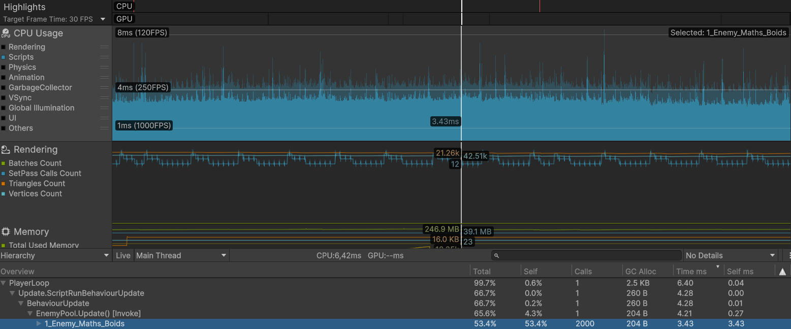

Even with the spatial grid, neighbor caching and separation updates spread over 4 frames, the horde steering runs on a single thread and its cost grows with every enemy added.

<a id="oop-benchmark-results"></a>
### OOP Benchmark Results

| Enemy Count | `EnemyPool.Update()` (ms) | Observed FPS | Playability |
|:---:|:---:|:---:|:---|
| **2,000** | 4.21 ms | > 144 FPS | Smooth and stable |
| **4,000** | 8.94 ms | ~120 FPS | Minor drops below the monitor refresh rate |
| **6,000** | 19.64 ms | ~60 FPS | Playable |
| **8,000** | 35.40 ms | ~30 FPS | Degraded, practical limit |
| **10,000** | **45.59 ms** | **< 20 FPS** | **Unplayable** |

> **OOP Conclusion**: the playable limit of the OOP implementation is **~8,000 enemies** (~30 FPS). The root cause is not the algorithm itself but the memory layout: each `GameObject` and `MonoBehaviour` is a separate object scattered across the heap, so the CPU spends much of its time waiting for data (cache misses), all on a single thread.

---

<a id="phase-2-dotsecs-hybrid-architecture"></a>
## Phase 2: DOTS/ECS & Hybrid Architecture

Only the massive part of the game (enemies and experience orbs) moved to ECS. The player, the weapons and the UI remain MonoBehaviours: converting objects that exist once brings no measurable gain and makes gameplay code harder to iterate on.

The architecture below is the current one, including the changes made in [Phase 3](#phase-3-profiling-driven-optimization).

### Data-Oriented Pipeline & Hybrid Bridge

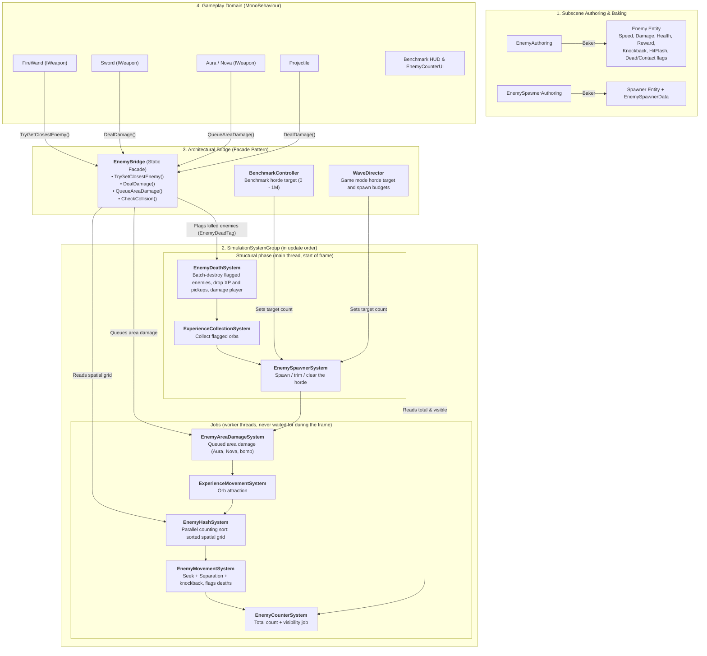

### Data-Oriented Design (DOD) Principles

```
Classic OOP (scattered heap objects):
[ Enemy 1: Transform | Health | Speed | Sprite ] -> pointer -> [ Enemy 2 ] -> ...   (cache misses)

DOTS / ECS (Structure of Arrays in 16 KB archetype chunks):
Chunk: [ Transform | Transform | Transform ... ]   <-- read linearly, prefetched by the CPU
       [ Speed     | Speed     | Speed     ... ]   <-- processed by Burst jobs on all cores
```

- **Archetype Chunks**: entities with the same set of components are packed contiguously in 16 KB chunks.
- **Cache Locality**: systems iterate over linear arrays, which the CPU prefetches efficiently.
- **Burst + Job System**: jobs are compiled to optimized native code (LLVM) and spread across all worker threads.

### Core Systems Overview

1. [`EnemyDeathSystem`](Assets/Scripts/Enemy/EnemyDeathSystem.cs): at the start of the frame, destroys every enemy flagged with `EnemyDeadTag` in one batch, drops their experience orbs (and, rarely, a pickup), updates the score and applies the damage of the enemies that touched the player. Gathering the structural changes here means no enemy job ever has to be waited for during its frame.
2. [`EnemySpawnerSystem`](Assets/Scripts/Enemy/EnemySpawnerSystem.cs): instantiates enemies along the camera edges until the target count is reached, and trims or clears the horde when the target drops. In Benchmark mode it fills the horde as fast as possible (up to 25,000 per frame); in Game mode it follows the spawn budgets of the `WaveDirector`, including elites, runner packs and the final boss.
3. [`EnemyAreaDamageSystem`](Assets/Scripts/Enemy/EnemyAreaDamageSystem.cs): applies the area damage queued by the weapons (rings and discs) in a parallel Burst job over all enemies: health, hit flash, knockback and death flag.
4. [`EnemyHashSystem`](Assets/Scripts/Enemy/EnemyHashSystem.cs): builds a sorted spatial grid with a parallel counting sort (keys and counting, prefix sum, scatter), so the enemies of a cell are stored contiguously in memory.
5. [`EnemyMovementSystem`](Assets/Scripts/Enemy/EnemyMovementSystem.cs): parallel Burst `IJobEntity` combining *Seek* and *Separation*. Separation is time-sliced over 4 frames, limited to 4 neighbors, and visits cells in a spiral order to avoid directional bias. The same job applies the knockback and fades the hit flash. Enemies touching the player are only flagged (`EnemyDeadTag` + `EnemyContactTag`), so the job never writes into a command buffer.
6. [`EnemyCounterSystem`](Assets/Scripts/UI/EnemyCounterSystem.cs): reads the total count from chunk metadata and counts on-screen enemies with a Burst job, for the HUD.
7. [`ExperienceMovementSystem` / `ExperienceCollectionSystem`](Assets/Scripts/Experience/ExperienceMovementSystem.cs): attract experience orbs towards the player, and collect them at the start of the next frame (through the `BeginSimulation` command buffer).

### Decoupling with the EnemyBridge Facade

[`EnemyBridge`](Assets/Scripts/Enemy/EnemyBridge.cs) keeps the gameplay code independent from ECS:
- **No leaky abstractions**: weapons and projectiles never import `Unity.Entities` nor access the ECS world directly.
- **Encapsulated grid**: the cell size is `internal` to the simulation; weapons simply call `EnemyBridge.TryGetClosestEnemy(origin, range, out target)`.
- **Single-pass damage**: `DealDamage` damages the enemies in range, flags the ones it kills and returns the hit count in one grid traversal, instead of a collision check followed by a damage query.
- **Area damage off the main thread**: `QueueAreaDamage` only records a request; `EnemyAreaDamageSystem` applies it to every enemy in a parallel job, so an Aura or a bomb hitting thousands of enemies costs almost nothing on the main thread.
- **Safe main-thread access**: the grid jobs are not waited for during their frame, so the bridge completes their handle before reading the grid (the jobs are long finished by then, so this costs nothing).

---

<a id="performance-comparison-hardware-analysis"></a>
## Performance Comparison & Hardware Analysis

### Test Machine

| Component | Specification |
|:---|:---|
| **Laptop** | HP Victus 15-fa0xxx |
| **CPU** | Intel Core i5-12450H (8 cores: 4 Performance + 4 Efficient, 12 threads) |
| **GPU** | NVIDIA GeForce RTX 3050 Laptop GPU (4 GB) |
| **RAM** | 16 GB DDR4 3200 MT/s |
| **OS** | Windows 11 (64-bit) |

### Methodology

- **Same conditions**: both implementations were measured on the machine above, in a development build connected to the Unity Profiler (no Editor overhead).
- **Simulation metric**: OOP measures `EnemyPool.Update()`; DOTS measures `SimulationSystemGroup` on the main thread. Since DOTS jobs run on worker threads, this includes scheduling the jobs *and waiting for them*, plus the XP orbs and the spawner: a slightly pessimistic but fair equivalent.
- **Frame metric**: `PlayerLoop`, the whole CPU frame (simulation, rendering preparation, UI).
- **Scenario**: the player stands still with a single weapon active, so the horde size stays stable during the capture.
- **Protocol**: profiler values come from a representative frame once the horde size is stable. FPS values are read from the in-game FPS counter.
- **Scope**: these measurements were taken before the [Game Mode](#game-mode) was added. The Benchmark mode keeps the same scenario (no waves, elites or pickups), but enemies now also carry health, knockback and hit-flash data, so the movement job does slightly more work than when it was measured.

### DOTS / ECS Results

| Enemies | Simulation (ms) | Time per Enemy (µs) | Full CPU Frame (ms) | In-game FPS |
|:---:|:---:|:---:|:---:|:---:|
| 2,000 | 0.24 | 0.120 | 2.73 | — |
| 4,000 | 0.29 | 0.073 | 2.62 | — |
| 6,000 | 0.31 | 0.052 | 2.63 | — |
| 8,000 | 0.41 | 0.051 | 3.04 | — |
| 10,000 | 0.50 | 0.050 | 2.78 | ~300 |
| 50,000 | 1.92 | 0.038 | 6.83 | ~160 |
| 100,000 | 4.14 | 0.041 | 9.88 | ~100 |
| **250,000** | **9.08** | **0.036** | **22.93** | **~40** |
| 500,000 | 19.02 | 0.038 | 43.00 | ~20 |
| 1,000,000 | 40.57 | 0.041 | 88.62 | ~10 |

Up to 10,000 enemies the cost is dominated by the fixed overhead of the ECS pipeline (system updates, job scheduling, synchronization). From 50,000 onwards, the simulation scales linearly at **~0.04 µs per enemy**.

<details>
<summary><b>Profiler captures (10k · 250k · 1M)</b></summary>

**10,000 enemies**: `SimulationSystemGroup` 0.50 ms, `PlayerLoop` 2.78 ms

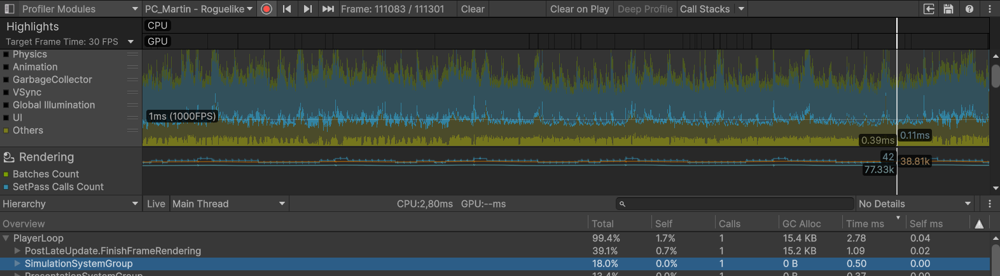

**250,000 enemies**: `SimulationSystemGroup` 9.08 ms, `PlayerLoop` 22.93 ms (practical limit)

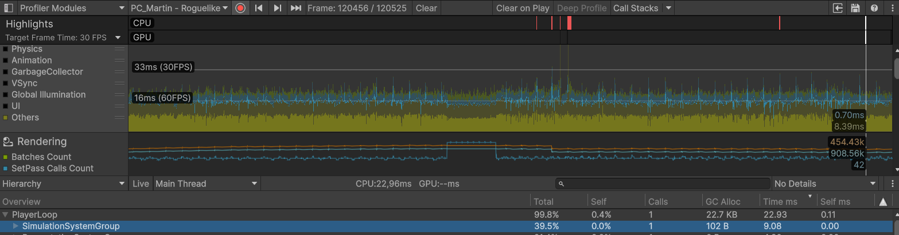

**1,000,000 enemies**: `SimulationSystemGroup` 40.57 ms, `PlayerLoop` 88.62 ms

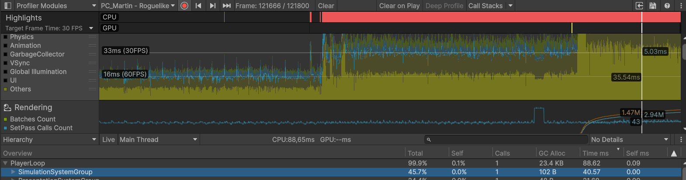

</details>

### Multithreading in Action (Phase 2 Timeline, 100,000 enemies)

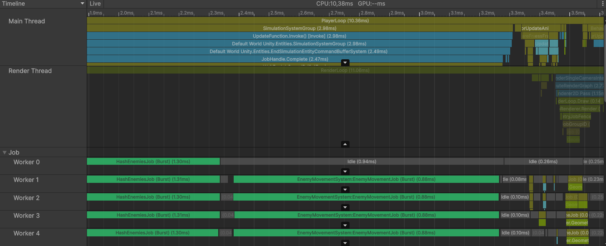

- **Every worker thread runs the enemy jobs at the same time**: `HashEnemiesJob` (~1.30 ms) then `EnemyMovementJob` (~0.88 ms), split across all cores. In OOP, this whole workload ran sequentially on the main thread.
- **The main thread only waits**: it schedules the jobs, then blocks in `JobHandle.Complete` (2.47 ms) inside the end-of-simulation command buffer system, which must wait for `EnemyMovementJob` before playing back its commands.
- **Building the spatial grid costs more than moving the enemies** (1.30 ms vs. 0.88 ms): every enemy inserts itself into a single shared `NativeParallelMultiHashMap`, and these concurrent insertions most likely cost more than the steering math itself.

### OOP vs. DOTS / ECS

| Enemies | OOP `EnemyPool.Update()` | DOTS `SimulationSystemGroup` | Speed-up |
|:---:|:---:|:---:|:---:|
| 2,000 | 4.21 ms | 0.24 ms | ×17.5 |
| 4,000 | 8.94 ms | 0.29 ms | ×30.8 |
| 6,000 | 19.64 ms | 0.31 ms | ×63.4 |
| 8,000 | 35.40 ms | 0.41 ms | ×86.3 |
| 10,000 | 45.59 ms | 0.50 ms | **×91.2** |

| Metric | Classic OOP (MonoBehaviour) | Unity DOTS / ECS | Improvement |
|:---|:---:|:---:|:---:|
| **Max Playable Entities (≥ 30 FPS)** | ~8,000 | **~250,000** (~40 FPS) | **~30×** |
| **Highest Count Tested** | 10,000 (< 20 FPS) | 1,000,000 (~10 FPS) | 100× |
| **Simulation Cost per Enemy** | ~4.6 µs (10k) | **~0.04 µs** | **~110×** |
| **Full CPU Frame @ 10,000 Entities** | 54.63 ms | **2.78 ms** | **~20×** |
| **Simulation Allocations per Frame** | 0 – 1 KB | **0 B** (102 B above 50k) | Negligible GC pressure |
| **Thread Utilization** | Main thread only | All job worker threads | Parallel |
| **Memory Layout** | Heap objects (scattered pointers) | Contiguous archetype chunks (SoA) | Far fewer cache misses |

### Where the New Bottleneck Is

- **The simulation is no longer the whole story**: with a large horde it only represents ~40–45% of the CPU frame. The rest goes to rendering and engine overhead, which explains why the full-frame gain (~20×) is smaller than the simulation gain (~91×). At 100,000 enemies, `PresentationSystemGroup` takes ~2.8 ms, and Entities Graphics uploads the enemies' transforms to the GPU with `ExecuteGpuUploads`, itself spread across all worker threads (~1.08 ms each):

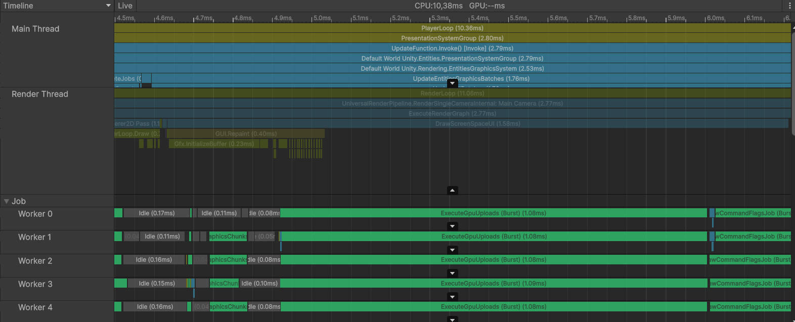

- **CPU is not the only limit**: the in-game FPS stays slightly below what the CPU frame alone would allow (~300 FPS observed vs. ~360 at 10,000 enemies), the difference coming from the GPU / render thread, which the main-thread profiler does not capture.
- **Spawning**: new enemies are instantiated on the main thread in batches of up to 25,000 per frame, which causes visible spikes when the target count is raised.
- **Garbage collection**: the ~9 KB allocated per frame on the `PlayerLoop` come from `PostLateUpdate.FinishFrameRendering` (render pipeline), not from the ECS simulation.
- **Not isolated here**: the gain combines contiguous memory, Burst compilation and multithreading, and the rendering path also differs (`SpriteRenderer` vs. Entities Graphics).

---

<a id="phase-3-profiling-driven-optimization"></a>
## Phase 3: Profiling-Driven Optimization

The Phase 2 Timeline revealed two weaknesses in the DOTS pipeline: the main thread waited **2.47 ms** per frame for the enemy jobs, and building the spatial grid (`HashEnemiesJob`, 1.30 ms) cost more than moving the enemies. I fixed them one step at a time, **measuring each change on its own** so every gain (or absence of gain) can be attributed to a precise cause.

### Step A: Removing the Synchronization Point

`EnemyMovementJob` recorded the enemies touching the player into the end-of-simulation command buffer, which therefore had to wait for the job, and the main thread with it.

- **Flags instead of commands**: the job now only enables `EnemyDeadTag` / `EnemyContactTag`. Enabling a component is not a structural change, so it is safe from a parallel job.
- **One structural phase at the start of the frame**: `EnemyDeathSystem` destroys the flagged enemies in one batch before any job is scheduled. Nothing waits for the enemy jobs during the frame anymore: they keep running while the main thread prepares the rendering.

| Enemies | 10k | 50k | 100k | 250k | 500k | 1M |
|:---|:---:|:---:|:---:|:---:|:---:|:---:|
| **In-game FPS, Phase 2** | ~300 | ~160 | ~100 | ~40 | ~20 | ~10 |
| **In-game FPS, Step A** | **~350** | ~160 | ~100 | ~43 | ~22 | ~11 |

A real gain with small hordes, negligible from 100k. The Timeline shows why:

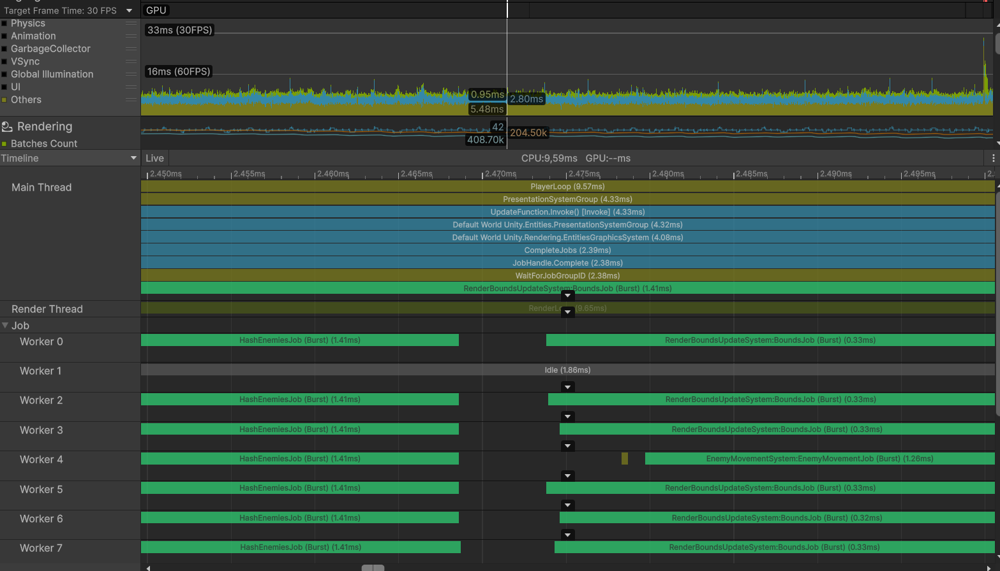

The main thread now waits **inside the rendering** instead (`JobHandle.Complete`, 2.38 ms): the rendering job `RenderBoundsUpdateSystem:BoundsJob` could not start because every worker was still busy with `HashEnemiesJob`. **With all cores saturated, removing a sync point only moves the wait: the only way to go faster is to give the workers less work.**

### Step B: A Sorted Spatial Grid

Every enemy inserted itself into a single shared `NativeParallelMultiHashMap`: concurrent insertions through shared counters, and the enemies of a cell scattered in memory as a linked list. I replaced it with a **counting sort** that stores the enemies contiguously by cell:

1. **Keys**: each enemy computes its cell and bucket, and writes them at its own index (no shared writes).
2. **Offsets**: count the enemies per bucket, then a prefix sum gives the start of each bucket.
3. **Scatter**: copy each enemy into its bucket, in one contiguous array.

The **first version** ran steps 2 and 3 in a single job: the CPU time of the grid was halved, but that job took **2.71 ms on one thread** while the other workers sat idle, making the grid *longer* to build than before. The **second version** parallelizes them: the counting and the scatter use atomic increments spread over ~131,000 bucket counters (so threads rarely collide, unlike the hash map's shared counters), leaving a 0.17 ms prefix sum as the only sequential step.

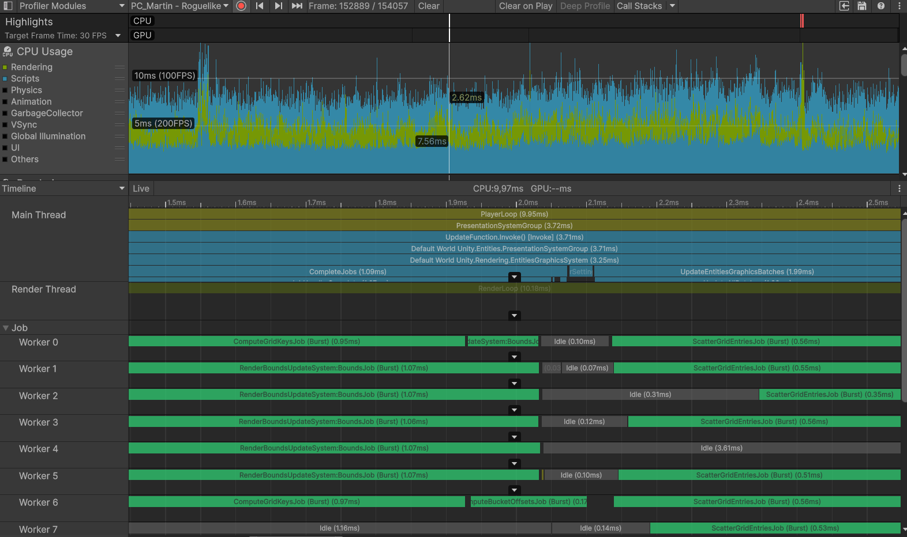

| Spatial grid (100k enemies) | Start to finish | CPU time (all threads) | `EnemyMovementJob` |
|:---|:---:|:---:|:---:|
| Hash map (Step A) | 1.41 ms | ~11 ms | 1.26 ms |
| Sequential counting sort (B v1) | ~3.0 ms | ~6 ms | **0.95 ms** |
| **Parallel counting sort (B v2)** | **~1.7 ms**\* | **~6 ms** | — |

\* While sharing the workers with the rendering jobs: since nothing waits for the simulation anymore, its jobs now interleave with the rendering ones.

<details>
<summary><b>First version: the single-threaded sort</b></summary>

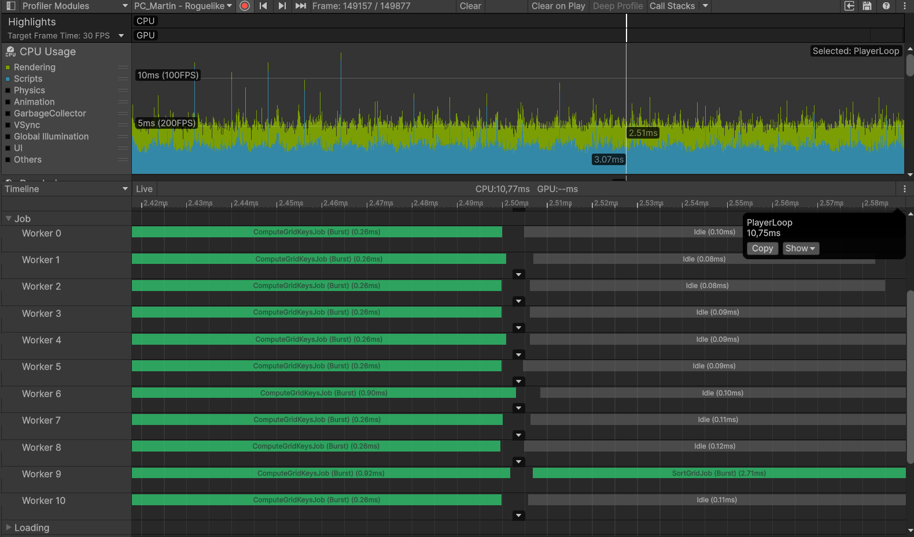

</details>

### Result: The Frame Is Now Bound by the Render Thread

Frame time measured as a **median over a few hundred frames** (Highlights module):

| Enemies | 50k | 100k | 250k | 500k | 1M |
|:---|:---:|:---:|:---:|:---:|:---:|
| **Frame, Phase 2** (single frame) | 6.83 ms | 9.88 ms | 22.93 ms | 43.00 ms | 88.62 ms |
| **Frame, Phase 3** (median) | 5.62 ms | 9.39 ms | 22.20 ms | 44.60 ms | 87.27 ms |

The difference is within the measurement noise, and the whole-frame Timeline shows why:

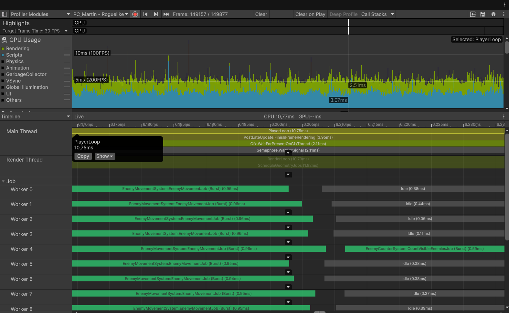

- **The render thread sets the pace**: `RenderLoop` takes 10.73 ms of a 10.75 ms frame, and the main thread ends the frame waiting for it (`Gfx.WaitForPresentOnGfxThread`, 2.11 ms) while the workers go idle.
- **The most expensive job is now a rendering job**: `ExecuteGpuUploads` (Entities Graphics) uploads the matrix of every enemy that moved (all of them, every frame): ~15–19 ms of CPU time across all threads at 100k, up to ~160–185 ms at 1M.

This is **Amdahl's law** in practice: the simulation is now a small part of the frame, so optimizing it further cannot show in the framerate. Phase 3 did not raise the FPS, but it reached its real goal: the bottleneck has moved out of the game simulation, which no longer blocks the main thread and costs about half as much CPU time to partition.

---

<a id="game-mode"></a>
## Game Mode: A Playable Survivor-like on Top of ECS

The benchmark scene doubles as a real game: a **5-minute survival run** whose horde grows from a handful of enemies to **20,000**, with elites, fast runner packs, four weapons with upgrades and mastery bonuses, rare pickups (heal, magnet, bomb) and a **final boss** at 5:00. The Benchmark mode is still one click away in the main menu.

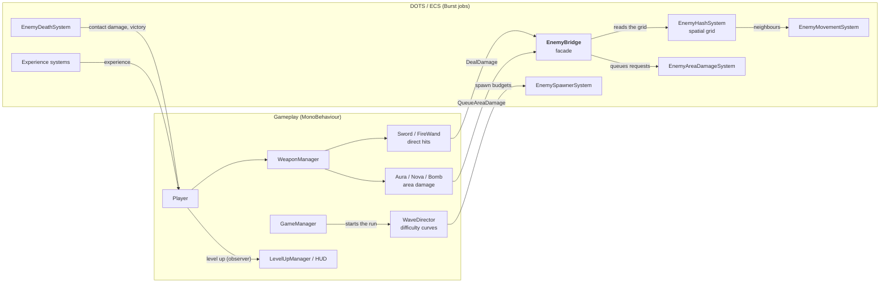

- **Same facade, new weapons**: area weapons can hit thousands of enemies at once, too many to process one by one on the main thread. They only queue a request through `EnemyBridge.QueueAreaDamage`; a parallel Burst job (`EnemyAreaDamageSystem`) applies the damage, the red hit flash and the knockback to every enemy in range.
- **Data-driven difficulty**: the `WaveDirector` drives the horde size, spawn rate, enemy health, elites and runner packs with `AnimationCurve`s tuned in the Inspector, and zooms the camera out as the horde grows.
- **Per-instance hit flash**: an `[MaterialProperty("_HitFlash")]` component is uploaded to the GPU by Entities Graphics, so each of the 20,000 enemies can flash independently without breaking batching.

---

<a id="challenges-lessons-learned"></a>
## Challenges & Lessons Learned

- **Command buffers delay structural changes, which makes double destruction possible.** An enemy hit by two projectiles in the same frame was queued for destruction twice, dropping two XP orbs and throwing an exception during playback. Each enemy now carries an enableable `EnemyDeadTag`, switched on as soon as its destruction is queued; weapons, player contact and the spawner all skip enemies that are already dying.
- **System order matters as soon as a system makes immediate structural changes.** Clearing the horde destroyed the XP orbs immediately, while a job had already queued a component addition on some of them, so the playback failed at random. The spawner now explicitly runs before the systems that record commands (`[UpdateBefore]`), instead of relying on an implicit order.
- **Main-thread time is not job time.** In ECS, a system only schedules its job: its own time is close to zero, and the real cost appears where the main thread waits for the job (here, in the end-of-simulation command buffer). Measuring the whole `SimulationSystemGroup`, or using the Timeline view, gives the real picture.
- **ECS has a fixed cost.** Below ~10,000 enemies, updating systems and scheduling jobs costs more than the enemies themselves, which is why the DOTS times barely move between 2,000 and 10,000.
- **Removing a sync point does not remove work.** Letting the enemy jobs overlap with the rendering only helped while some cores were idle; once the workers were saturated, the wait simply moved into the rendering.
- **Jobs that outlive their frame must be completed explicitly.** After Step A, the weapons read the spatial grid at the start of the next frame: the job had finished long before, but Unity's safety system still threw an exception because nothing had called `Complete()` on it.
- **Less total work can still be slower.** The first sorted grid halved the CPU time but ran its sort on a single thread, lengthening the critical path. Parallelizing it with atomics spread over many counters fixed it.
- **Baking merges render data per subscene.** All the enemy prefabs share a single `RenderMeshArray`: registering "the first mesh and material" gave every elite the regular enemy's sprite. The spawner now reads each prefab's own index from its `MaterialMeshInfo`.
- **Entities Graphics ignores sorting layers.** Enemies are drawn by the `BatchRendererGroup`, so sprite sorting layers and orders have no effect on them, and sorting transparent sprites by distance was unreliable in builds. Enemies and orbs are now opaque (alpha clip) and ordered by the depth buffer, and the ground and the Aura are drawn first through their render queue.
- **Change the measurement when the code changes.** Once the main thread stopped waiting for the jobs, `SimulationSystemGroup` dropped to a fraction of a millisecond without the simulation being cheaper: from then on, the frame time, the FPS and the Timeline job durations were the only meaningful metrics.

---

<a id="next-steps"></a>
## Next Steps

- **Rendering**: the frame is now bound by the render thread and `ExecuteGpuUploads`. Avoiding the upload of hundreds of thousands of matrices every frame (e.g. a custom instanced renderer reading the enemy positions from a single GPU buffer) is the next real lever.
- Move the spawning loop into a Burst job to remove the spikes when the horde grows.
- Isolate the respective contributions of Burst and multithreading (single worker thread vs. all threads).
- Re-measure Phase 2 with medians, for a strict before/after comparison with Phase 3.

---

<a id="getting-started"></a>
## Getting Started

**Requirements**: Unity **6000.4.5f1** (the DOTS packages are resolved automatically from `Packages/manifest.json`).

| Branch | Content |
|:---|:---|
| `main` | DOTS / ECS implementation |
| `Gameplay` | DOTS / ECS implementation with the Game mode |
| `ObjectOrientedProgramming` | Classic OOP implementation (Phase 1) |

1. Clone the repository and check out the branch to benchmark.
2. Open the project in Unity and load `Assets/Scenes/SampleScene.unity`.
3. Press Play and choose **Play** (Game mode) or **Benchmark** in the main menu.
4. To reproduce the measurements, create a **Development Build** with **Autoconnect Profiler** enabled, start the **Benchmark** mode, then use the [benchmark HUD](#controls-in-game-benchmark-hud) to set the horde size.

---

<a id="controls-in-game-benchmark-hud"></a>
## Controls & In-Game Benchmark HUD

The benchmark controls are only active in Benchmark mode.

| Hotkey / Control | Action | Details |
|:---:|:---|:---|
| **1 – 7** (Main / Numpad) | **Target Presets** | `1`: 1,000 &bull; `2`: 5,000 &bull; `3`: 10,000 &bull; `4`: 50,000 &bull; `5`: 100,000 &bull; `6`: 500,000 &bull; `7`: 1,000,000 |
| **+** / **-** | **Horde Step** | Adjust horde target by $\pm$ 10,000 (Hold **Shift** for $\pm$ 50,000) |
| **HUD buttons** | **Fine Adjustments** | `-50k` &bull; `-10k` &bull; `-1k` &bull; `+1k` &bull; `+10k` &bull; `+50k` &bull; `Clear All` |
| **C** or **Delete** | **Clear All** | Destroys all active enemies and XP orbs |
| **F1** | **Toggle HUD** | Shows / hides the on-screen benchmark interface |
| **W, A, S, D** (Z, Q, S, D on AZERTY) | **Movement** | Player controls |
| **Escape** | **Pause** | Resume, switch mode, main menu, quit |

---

<a id="code-conventions"></a>
## Code Conventions

- **Project naming conventions**: `m` prefix for fields (`mSpatialGrid`), `s` for static fields (`sInstance`), `p` for parameters (`pDeltaTime`), `l` for local variables (`lPlayerPos`), PascalCase for constants (`CellSize`).
- **Native memory**: every native container (`NativeArray`, `NativeReference`) is disposed in `OnDestroy()`.
- **Safe structural changes**: all structural changes happen in one phase at the start of the frame; jobs and weapons only enable flags (`EnemyDeadTag`), so an enemy can never be destroyed twice.
- **Documentation**: public types, systems and methods are documented with XML doc comments.

---

<a id="tech-stack"></a>
## Tech Stack
- **Engine**: Unity 6 (6000.4.5f1)
- **DOTS Packages**: `com.unity.entities` (6.4.0), `com.unity.entities.graphics` (6.4.0), `com.unity.burst` (1.8.29), `com.unity.mathematics` (1.3.3)
- **Input System**: `com.unity.inputsystem` (1.19.0)
- **Camera**: Cinemachine (2.10.7)
- **Rendering**: Universal Render Pipeline (17.4.0), Entities Graphics (`BatchRendererGroup`)
